# DotNetNote 설치하기

『ASP.NET & Core를 다루는 기술』의 ASP.NET Core 파트 예제인 DotNetNote를 로컬 개발 환경에 설치하고 실행하는 방법을 설명합니다. 이 문서는 ASP.NET Core 11.0으로 업데이트된 소스를 기준으로 합니다.

## 1. 개발 환경 준비

- Visual Studio: **ASP.NET 및 웹 개발**, **데이터 저장 및 처리** 워크로드
- .NET 11 SDK
- SQL Server Express LocalDB 및 SQL Server Data Tools(SSDT)
- [DotNetNote 소스 코드(GitHub)](https://github.com/VisualAcademy/DotNetNote)

GitHub에서 소스를 내려받거나 Git으로 복제합니다.

```powershell
git clone https://github.com/VisualAcademy/DotNetNote.git
```

`DotNetNote/DotNetNote.slnx` 또는 `DotNetNote/DotNetNote.sln`을 Visual Studio에서 엽니다. 이 리포지토리에는 이전 버전의 예제 프로젝트도 있으므로 최신 솔루션을 선택합니다.

## 2. SQL Server 데이터베이스 게시

### 2.1. 데이터베이스 프로젝트 게시 메뉴 열기

솔루션 탐색기에서 `DotNetNote.SqlServer` 프로젝트를 마우스 오른쪽 단추로 클릭하고 게시(Publish)를 선택합니다.

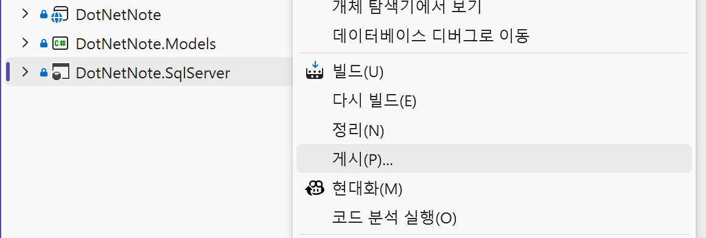

### 2.2. 대상 데이터베이스 연결 설정

데이터베이스 게시 창에서 대상 데이터베이스 연결 오른쪽의 **편집(Edit)** 단추를 클릭합니다.

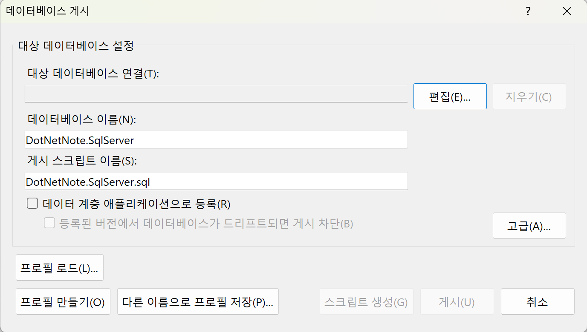

연결 창이 열리면 서버 이름과 인증 방식을 지정할 수 있습니다. **찾아보기** 탭을 선택하여 로컬 SQL Server 인스턴스를 확인합니다.

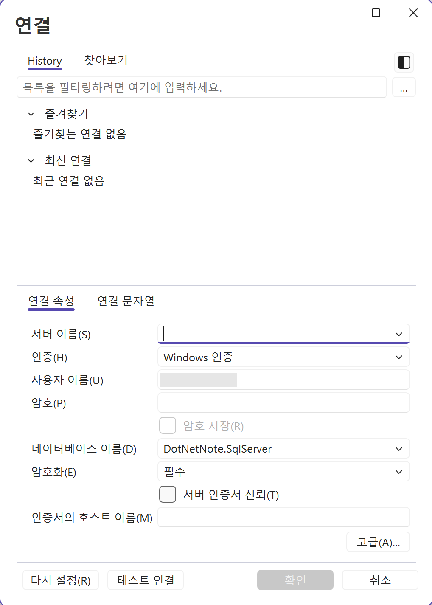

로컬 목록에서 `(localdb)\MSSQLLocalDB`를 선택합니다. 인증은 **Windows 인증**을 사용합니다. 연결 창의 데이터베이스 이름은 새 데이터베이스를 게시할 경우 기본값으로 두고, 게시 창에서 이름을 지정합니다.

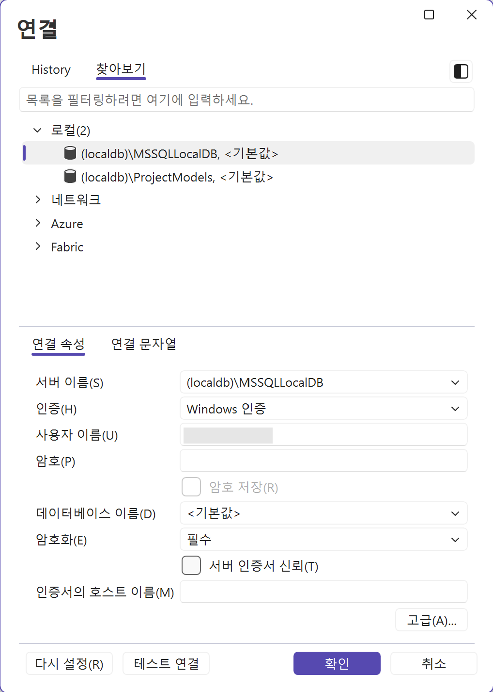

**확인**을 클릭한 후 데이터베이스 게시 창의 **데이터베이스 이름**을 `DotNetNote`로 변경합니다. 프로젝트 이름인 `DotNetNote.SqlServer`와 실제 데이터베이스 이름인 `DotNetNote`를 구분합니다.

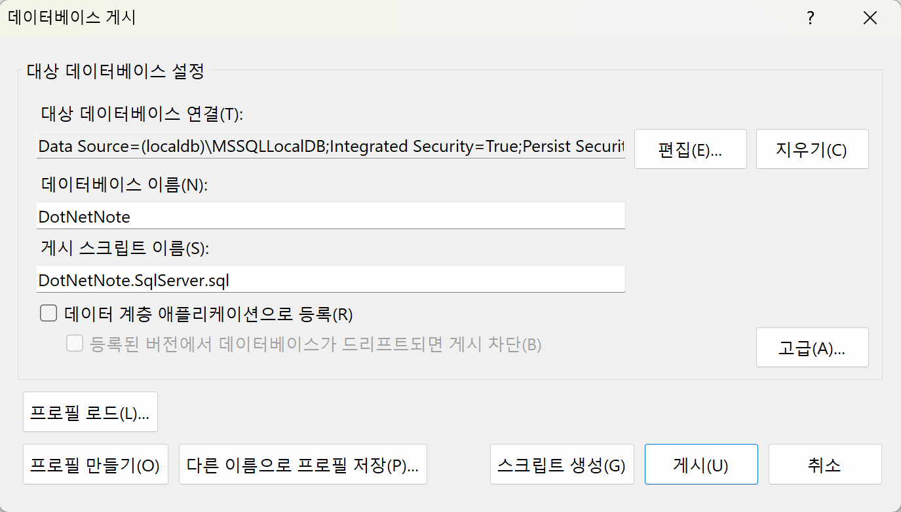

### 2.3. 데이터베이스 게시 완료

**게시(Publish)** 단추를 클릭합니다. 데이터 도구 작업 창에서 게시 미리 보기, 데이터베이스 스크립트 생성 및 실행 과정이 정상 완료되었는지 확인합니다.

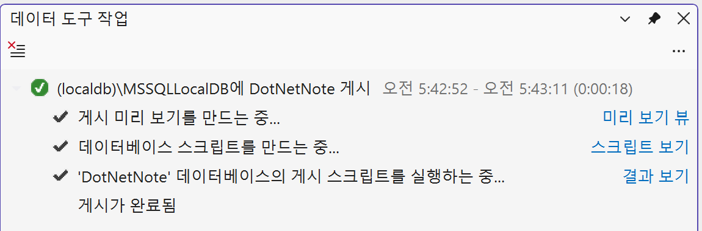

> [!NOTE]
> 기존 데이터베이스에 다시 게시할 때는 게시 미리 보기에서 변경 사항을 확인하고 필요한 데이터를 백업합니다.

## 3. 데이터베이스 생성 확인

Visual Studio의 보기(View) > SQL Server 개체 탐색기(SQL Server Object Explorer)를 선택합니다.

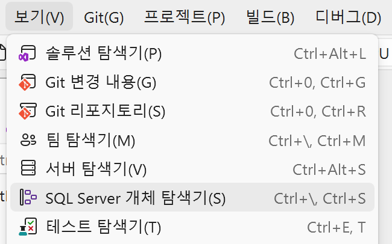

`SQL Server > (localdb)\MSSQLLocalDB > 데이터베이스`를 차례대로 펼쳐 `DotNetNote` 데이터베이스를 확인합니다. 필요한 경우 새로 고침합니다.

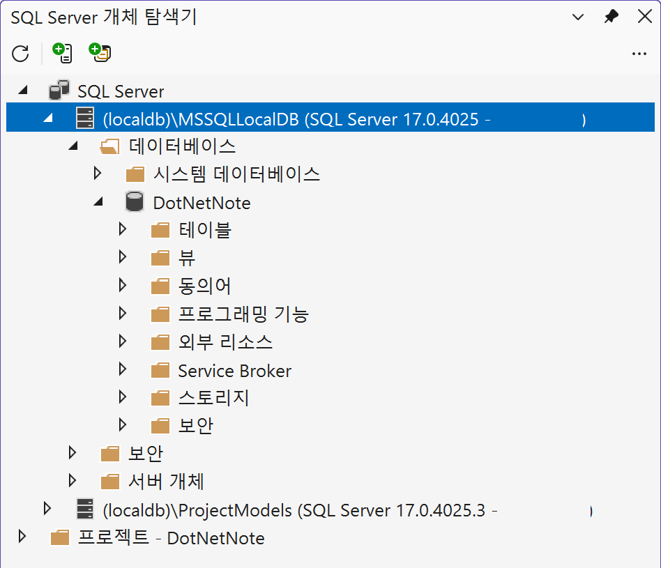

데이터베이스 아래의 **테이블**을 펼쳐 게시된 테이블을 확인합니다.

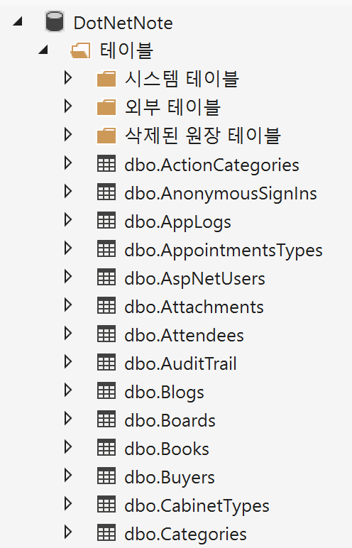

## 4. 데이터베이스 연결 문자열 확인

웹 프로젝트의 `DotNetNote/DotNetNote/appsettings.json`에서 `ConnectionStrings:DefaultConnection`이 게시한 데이터베이스를 가리키는지 확인합니다. 로컬 개발용 설정 예시는 다음과 같습니다.

```json
{
  "ConnectionStrings": {
    "DefaultConnection": "Server=(localdb)\\MSSQLLocalDB;Database=DotNetNote;Trusted_Connection=True;TrustServerCertificate=True;"
  }
}
```

기존 `appsettings.json` 전체를 위 예제로 교체하지 말고 해당 연결 문자열만 확인하거나 수정합니다. 사용자 비밀(User Secrets), 환경 변수 및 `appsettings.Development.json`에서 연결 문자열을 재정의한 경우 해당 값도 확인합니다.

`TrustServerCertificate=True`는 이 예제의 로컬 개발 환경에 한정하여 사용합니다. 운영 환경에서는 올바른 인증서 검증과 별도 보안 설정을 적용합니다.

## 5. DotNetNote 실행

### 5.1. 시작 프로젝트 설정

솔루션 탐색기에서 웹 프로젝트 `DotNetNote`를 마우스 오른쪽 단추로 클릭하고 **시작 프로젝트로 설정**을 선택합니다.

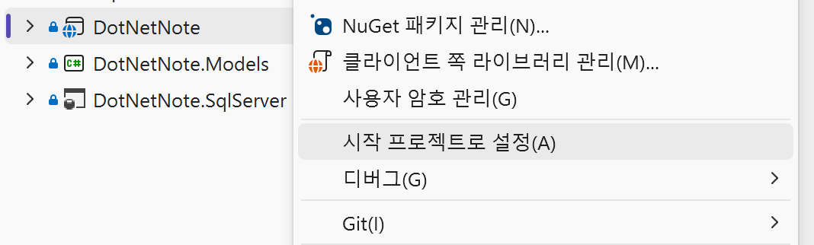

### 5.2. 디버깅하지 않고 시작

디버그(Debug) > 디버깅하지 않고 시작(Start Without Debugging)을 선택하거나 `Ctrl+F5`를 누릅니다. 디버깅이 필요하면 `F5`로 실행해도 됩니다.

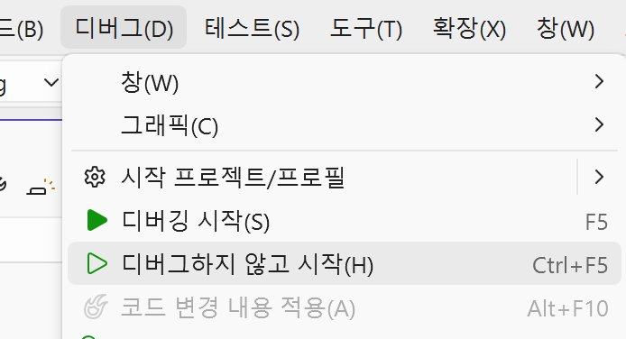

DocFX가 빌드 과정에서 문서를 자동 생성합니다. 최초 실행 시에는 NuGet 패키지 및 DocFX 도구를 내려받기 위한 네트워크 연결이 필요할 수 있습니다.

### 5.3. 개발용 HTTPS 인증서 확인

IIS Express 실행 프로필을 처음 사용할 때는 SSL 인증서를 신뢰할지 묻는 대화상자가 표시될 수 있습니다. 자신이 실행한 로컬 개발 환경의 인증서임을 확인한 뒤 **예**를 선택합니다.

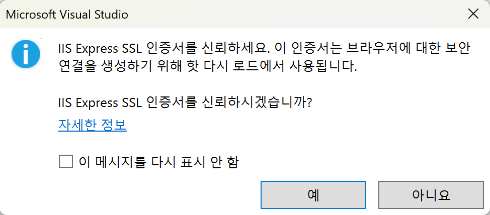

Windows 보안 경고가 추가로 표시되면 `localhost` 개발용 인증서가 맞는지 확인합니다. 알 수 없는 인증서나 운영 환경의 인증서는 무조건 신뢰하지 않습니다.

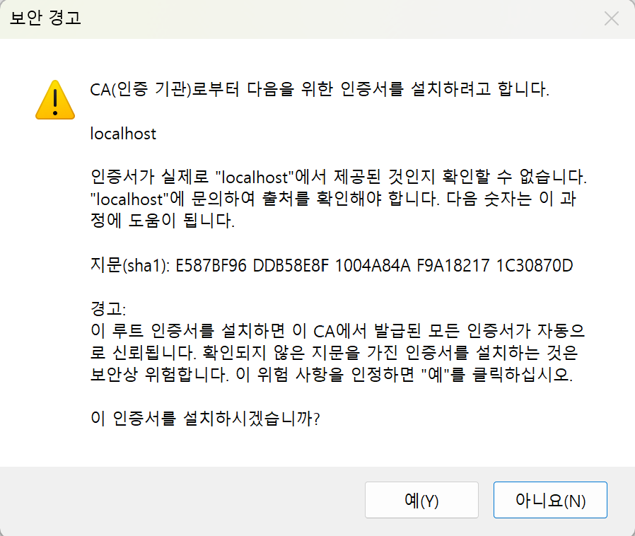

인증서가 이미 신뢰되어 있거나 다른 실행 프로필을 사용하는 경우에는 이 단계가 표시되지 않을 수 있습니다.

### 5.4. 메인 페이지 확인

브라우저에 DotNetNote 메인 페이지가 표시되는지 확인합니다. 포트 번호는 실행 프로필에 따라 다를 수 있습니다.

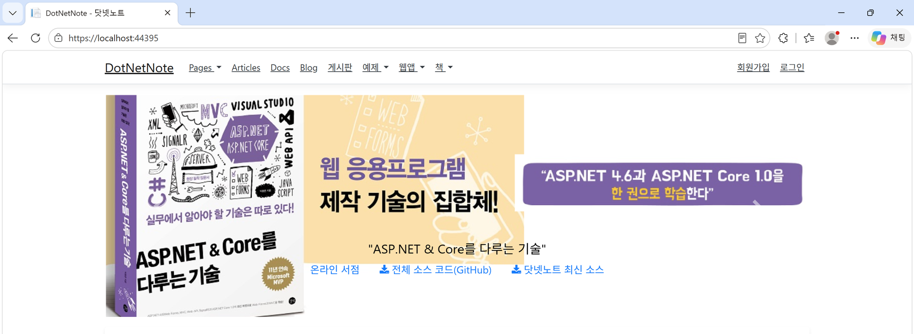

## 6. Admin 회원가입 및 로그인

이 단계는 책의 기존 DotNetNote 회원 관리 예제인 `/User` 기능을 사용합니다. MVC Identity 및 Blazor Identity의 별도 계정 관리 예제와 혼동하지 않도록 합니다.

### 6.1. 회원가입

메인 페이지 오른쪽 상단의 **회원가입**을 클릭합니다. 로컬 학습 환경에서는 아이디 `Admin`과 직접 정한 비밀번호를 입력하고 **가입**을 클릭합니다.

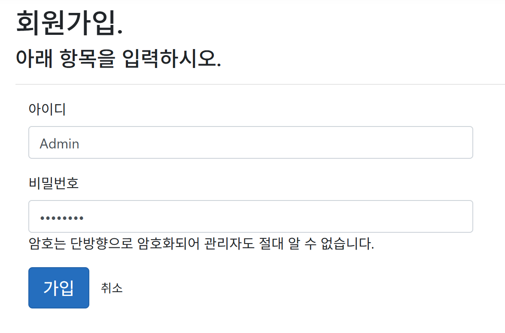

`Admin`은 기본 `DotNetNoteSettings:SiteAdmin` 설정과 일치하는 학습용 관리자 아이디입니다. 관리자가 이미 존재한다면 중복 가입하지 않고 기존 계정으로 로그인합니다. 공개 운영 환경에서는 관리자 아이디를 일반 가입자가 선점할 수 없도록 별도 접근 및 계정 생성 정책을 적용해야 합니다.

### 6.2. 로그인

회원가입이 끝나면 로그인 페이지로 이동합니다. 필요한 경우 상단 **로그인** 메뉴 또는 `/User/Login/`을 엽니다. 등록한 아이디와 비밀번호를 입력하고 **로그인**을 클릭합니다.

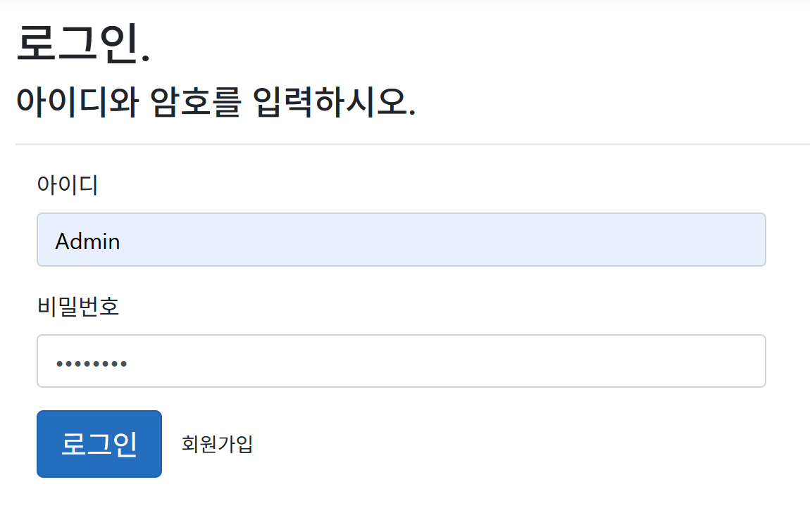

메인 페이지에서 `Admin 님, 반갑습니다.`라는 안내가 표시되는지 확인합니다.

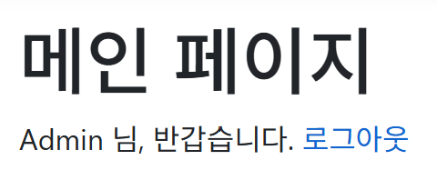

## 7. 관리자 대시보드 확인

Admin으로 로그인하면 상단 메뉴에 **대시보드**가 표시됩니다. 해당 메뉴를 클릭합니다.

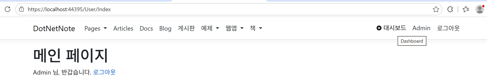

관리자 페이지에는 다음 세 가지 관리 기능이 표시됩니다.

- 게시판 관리자 페이지
- 사용자 관리자 페이지
- 커뮤니티 캠프 관리자 페이지

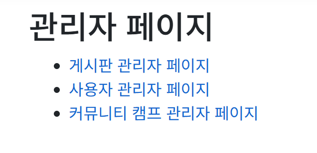

### 7.1. 게시판 관리자 페이지

**게시판 관리자 페이지** 링크를 클릭하여 해당 관리 예제 페이지가 표시되는지 확인합니다.


### 7.2. 사용자 관리자 페이지

관리자 페이지로 돌아가 **사용자 관리자 페이지** 링크를 클릭합니다.


### 7.3. 커뮤니티 캠프 관리자 페이지

**커뮤니티 캠프 관리자 페이지** 링크를 클릭하여 참가자 리스트와 참가 등록 기능을 확인합니다.

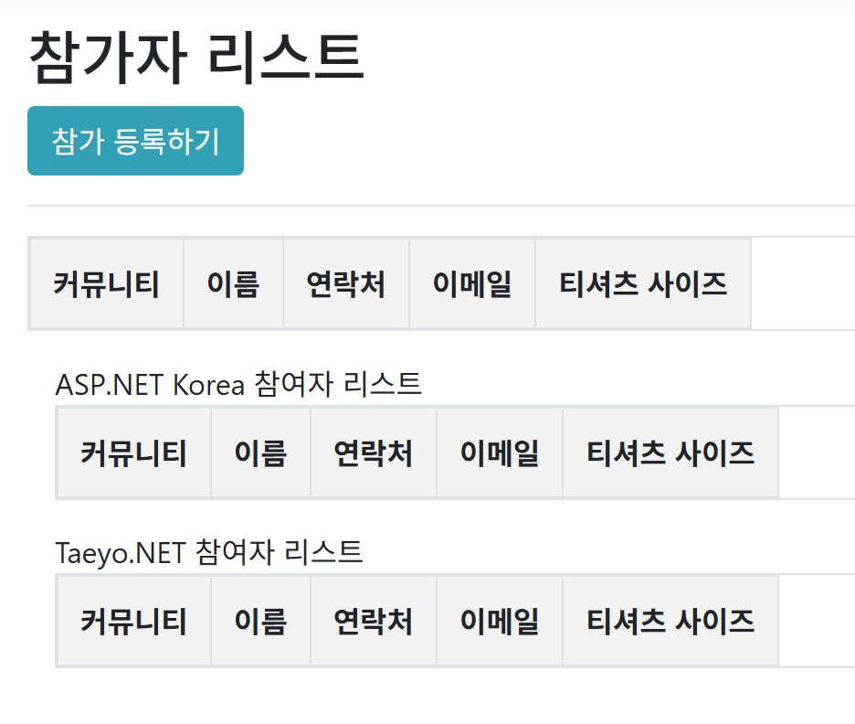

## 8. 설치 완료 및 문서 확인

메인 페이지의 **Docs** 메뉴를 클릭하거나 현재 실행 주소 뒤에 `/docs/`를 입력합니다. 설치 문서는 `/docs/dotnetnote/install-dotnetnote/`에서 확인할 수 있습니다.

설치가 완료되면 기존 게시판 및 MVC, Razor Pages, Blazor, Web API 학습 예제를 사용할 수 있습니다.

## 자주 발생하는 문제

| 증상 | 확인할 내용 |
| --- | --- |
| LocalDB 서버가 목록에 없음 | SQL Server Express LocalDB 및 SSDT 설치 여부 |
| 데이터베이스 연결 오류 | `ConnectionStrings:DefaultConnection`과 데이터베이스 이름 |
| 관리자 메뉴가 보이지 않음 | 기존 DotNetNote 계정 로그인 및 `DotNetNoteSettings:SiteAdmin` 설정 |
| 대시보드 접근 시 로그인 페이지로 이동 | 최신 소스의 `Administrators` 정책과 기존 `Cookies` 인증 스키마 적용 여부 |
| `/docs/` 접근 시 404 오류 | DocFX 빌드 성공 여부 및 `obj/DocFxSite/index.html` 생성 여부 |

문서 수정 및 게시 방법은 [DocFX 빌드 및 배포](../../guides/build-and-publish/index.md)를 참고합니다.
